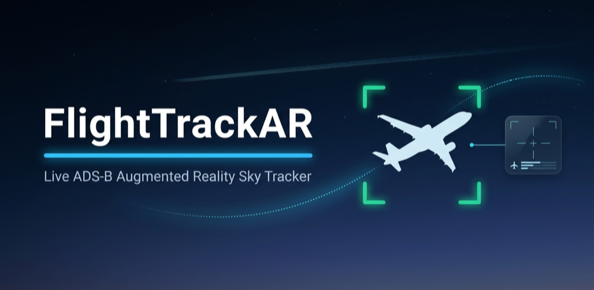

# FlightTrackAR



**FlightTrackAR** is a native Android augmented-reality flight tracker (Kotlin + Jetpack Compose + CameraX) that overlays openly available ADS-B aircraft data directly onto your live camera view of the sky, compensates for ADS-B reporting delay using a **3D Constant Turn Rate & Velocity (CTRV) Extended Kalman Filter**, and uses an **on-device Day/Night computer-vision detector** to lock bounding boxes onto visible aircraft.

---

## Key Features

- **Multi-Provider Open ADS-B Feed (No API Key Required)**
  - **Auto mode** queries [`airplanes.live`](https://airplanes.live/) (~2 s updates with `track_rate` and `seen_pos`) and automatically falls back to [`adsb.lol`](https://www.adsb.lol/) and the [OpenSky Network](https://opensky-network.org/).
  - Includes a built-in **Demo Simulation** mode with synthetic cruising, climbing, descending, and banking flights (with simulated 2.5 s ADS-B delay) for indoor or offline testing.
- **3D CTRV Extended Kalman Filter (Delay Compensation & Motion Prediction)**
  - Tracks each aircraft in a local East-North-Up (ENU) meter frame using a 7-state CTRV state vector $[p_E, p_N, p_U, v_h, \psi, \omega, v_z]^T$.
  - Automatically extrapolates forward from the report's actual fix timestamp (`seen_pos` / `time_position`) to real time at ~30 Hz, using reported turn rate (`track_rate`) when available or EKF-inferred turn rate from heading updates when omitted.
  - Optional **Future Prediction Lead slider** (`+0 s` to `+15 s`) to visualize projected trajectories ahead of live time.
- **ADS-B-Guided Day & Night Camera Vision (Visual Bounding Boxes)**
  - Runs real-time `YUV_420_888` analysis directly on CameraX frames mapped pixel-for-pixel to the preview viewport.
  - **Auto Sky Classification** distinguishes Day skies, Night skies (with dusk hysteresis), and cluttered/obstructed scenes (trees/indoors) to suppress false positives.
  - **Day Mode**: local sky-ring background subtraction + adaptive MAD contrast blob detection for dark silhouettes and sunlit glints.
  - **Night Mode**: dark-sky noise-floor peak detector for nav/landing lights, red-beacon chroma boost, screen-velocity consistency (rejecting static stars), and temporal strobe-flash detection (`STROBE` lock badge).
- **Precision Geodesy, Sensor Fusion & Multi-Lens Zoom**
  - Exact WGS84 → ECEF → ENU transforms (accounts for Earth curvature at long slant ranges) and automatic `GeomagneticField` declination correction (True North vs. Magnetic North).
  - Reads physical Camera2 sensor size & focal length, accounts for `PreviewView` `FILL_CENTER` cropping, and dynamically recalibrates FOV across pinch-to-zoom and quick lens presets (`0.5x`, `1x`, `2x`, `5x`, `10x`).
- **Interactive Aviation HUD & Calibration**
  - **Flight Details Sheet**: tap any reticle or bounding box for callsign, aircraft type, registration, ICAO24, baro/geo altitude, ground speed, vertical rate, track, turn rate (ADS-B vs. EKF), slant distance, bearing/elevation, squawk, and visual lock diagnostics.
  - **Compass & Pitch Calibration (`CAL`)**: manual azimuth/pitch nudge controls (`±0.5°`, `±2°`), one-tap **Lock-On Sync** (aligns compass/pitch drift directly to a visually locked plane), and optional continuous **Auto** visual trim.
  - **Debug / Tracker HUD (`DBG`)**: overlays raw delayed ADS-B fixes → EKF compensation vectors, future CTRV trajectory curves (`+3s`, `+6s`, `+9s`), CV search ROI boxes, sky luminance/FPS, effective FOV, and live lead-time tuning.

---

## Architecture

```text
app/src/main/java/com/flighttrackar/
├── MainActivity.kt               # Edge-to-edge host, Camera & Location permission gate
├── model/
│   ├── AircraftModels.kt         # ObserverLocation, DeviceOrientation, CameraIntrinsics, TrackedAircraft, VisualDetection
│   └── AppSettings.kt            # Provider, VisionMode, UnitSystem, CalibrationOffsets
├── math/
│   ├── GeoMath.kt                # WGS84 <-> ECEF <-> ENU, Az/El/Range, angle wrapping
│   └── CameraProjection.kt       # Declination + 3D orientation + FILL_CENTER zoom projection & inverse calibration
├── tracking/
│   ├── CtrvEkfTracker.kt         # 7-state 3D CTRV Extended Kalman Filter (Joseph-form updates)
│   └── FlightTrackManager.kt     # Multi-aircraft track lifecycle, origin recentering, 30 Hz extrapolation
├── data/
│   ├── AdsbRepository.kt         # airplanes.live, adsb.lol, OpenSky Network parsers & fallback chain
│   └── SimulatedAdsbProvider.kt  # Synthetic flights for offline/indoor testing
├── sensors/
│   ├── OrientationSensorManager.kt # TYPE_ROTATION_VECTOR + display remapping + adaptive quaternion smoothing
│   └── LocationTracker.kt        # FusedLocationProviderClient + LocationManager fallback + GeomagneticField
├── vision/
│   ├── SkyAircraftDetector.kt    # Pure-Kotlin Day/Night sky classifier, blob/strobe tracker & temporal smoother
│   └── CameraAnalyzer.kt         # CameraX YUV_420_888 ImageAnalysis adapter with exact rotation & crop mapping
└── ui/
    ├── FlightArViewModel.kt      # State orchestration, ADS-B polling loop, 30 Hz projection & CV fusion
    ├── FlightArScreen.kt         # Main HUD, compass bar, quick toggles, debug strip & zoom preset bar
    ├── CameraPreviewContainer.kt # CameraX Preview + ImageAnalysis + Camera2 intrinsics + pinch-to-zoom
    ├── ArFlightOverlay.kt        # Canvas renderer for reticles, data tags, visual brackets & debug vectors
    ├── FlightDetailSheet.kt      # Tap-to-inspect flight telemetry modal sheet
    ├── CalibrationControls.kt    # Azimuth/pitch nudge card & Visual Lock-On Sync
    └── SettingsSheet.kt          # Data source, vision mode, units, radius, lead time & privacy/attribution
```

---

## Requirements & Building

- **Android SDK:** `compileSdk 36` (Android 16), `targetSdk 36`, `minSdk 26` (Android 8.0+)
- **JDK:** Java 17
- **Gradle:** Wrapper included (`Gradle 8.11.1`, AGP `8.9.1`, Kotlin `2.0.21`)

### Run Unit Tests & Build Debug APK

```bash
./gradlew testDebugUnitTest assembleDebug
```

Unit test suites cover WGS84/ENU geodesy & camera projection (`GeoMathAndProjectionTest`), 3D CTRV EKF delay & turn-rate prediction (`CtrvEkfTrackerTest`), readsb v2 & OpenSky JSON parsing (`AdsbParserTest`), and Day/Night/Obstructed CV detection (`SkyAircraftDetectorTest`).

### Install on a Device

```bash
adb install -r app/build/outputs/apk/debug/app-debug.apk
adb shell am start -n com.thomasantony.flighttrackar.debug/com.flighttrackar.MainActivity
```

---

## Google Play Store Release Build

Application ID: `com.thomasantony.flighttrackar`

1. Generate an upload keystore (keep it backed up safely and **never commit it**):
   ```bash
   keytool -genkey -v -keystore release-upload-key.jks \
     -keyalg RSA -keysize 2048 -validity 10000 -alias upload
   ```
2. Copy `keystore.properties.example` to `keystore.properties` (gitignored) and fill in your keystore path, alias, and passwords (or set `KEYSTORE_FILE`, `KEYSTORE_PASSWORD`, `KEY_ALIAS`, `KEY_PASSWORD` in CI).
3. Build the signed, R8-minified Android App Bundle (`.aab`):
   ```bash
   ./gradlew bundleRelease
   ```
   Output bundle: `app/build/outputs/bundle/release/app-release.aab`
   R8 mapping file: `app/build/outputs/mapping/release/mapping.txt`

See [store/PLAY_STORE_LISTING.md](store/PLAY_STORE_LISTING.md) for the complete Play Console checklist, store copy, Data Safety questionnaire answers, and graphic assets in `store/assets/`.

---

## Privacy & Open Data Attribution

- **Privacy Policy:** [PRIVACY_POLICY.md](PRIVACY_POLICY.md) (HTML version ready for GitHub Pages in [docs/privacy-policy.html](docs/privacy-policy.html)). Camera frames are processed exclusively on-device in memory and are never recorded, stored, or transmitted.
- **Open ADS-B Networks:** Live flight data is courtesy of community-operated open ADS-B feeds: [airplanes.live](https://airplanes.live/), [adsb.lol](https://www.adsb.lol/), and the [OpenSky Network](https://opensky-network.org/).
